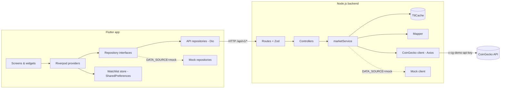
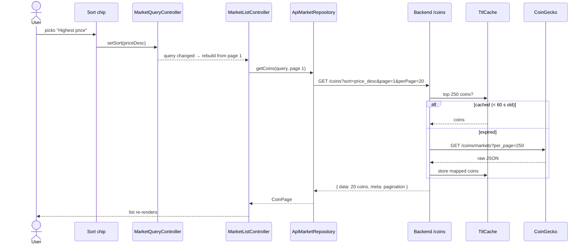
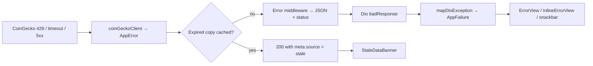

# Crypto Market & Research App — Technical Document

| | |
|---|---|
| **Author** | Ragavendar S |
| **Repositories** | [crypto_market_frontend](https://github.com/ragavendars21/crypto_market_frontend) (Flutter) · [crypto_market_backend](https://github.com/ragavendars21/crypto_market_backend) (Node.js) |
| **Status** | Feature complete; all automated checks passing locally and on GitHub Actions (see §21) |
| **Document date** | 26 October 2026 (updated 27 October 2026) |

This document describes the application as it was actually built and tested. Where something
was not verified, it says so.

---

## Contents

1. [Project overview](#1-project-overview)
2. [Original task requirements](#2-original-task-requirements)
3. [Features implemented](#3-features-implemented)
4. [Technology stack and justification](#4-technology-stack-and-justification)
5. [Flutter architecture](#5-flutter-architecture)
6. [Node.js backend architecture](#6-nodejs-backend-architecture)
7. [Architecture and data-flow diagrams](#7-architecture-and-data-flow-diagrams)
8. [Project folder structure](#8-project-folder-structure)
9. [Responsibilities of important files](#9-responsibilities-of-important-files)
10. [UI/UX design system](#10-uiux-design-system)
11. [State management and navigation](#11-state-management-and-navigation)
12. [Data models and API contracts](#12-data-models-and-api-contracts)
13. [External cryptocurrency API integration](#13-external-cryptocurrency-api-integration)
14. [Backend endpoint documentation](#14-backend-endpoint-documentation)
15. [Search, sorting and filtering implementation](#15-search-sorting-and-filtering-implementation)
16. [Historical chart implementation](#16-historical-chart-implementation)
17. [Watchlist persistence](#17-watchlist-persistence)
18. [Loading, error and empty-state handling](#18-loading-error-and-empty-state-handling)
19. [Security and configuration](#19-security-and-configuration)
20. [Caching and performance](#20-caching-and-performance)
21. [Testing strategy and actual test results](#21-testing-strategy-and-actual-test-results)
22. [Setup and execution instructions](#22-setup-and-execution-instructions)
23. [Troubleshooting](#23-troubleshooting)
24. [Known limitations](#24-known-limitations)
25. [Future improvements](#25-future-improvements)
26. [Recruiter interview questions and answers](#26-recruiter-interview-questions-and-answers)
27. [A 60-second project introduction](#27-a-60-second-project-introduction)
28. [A three-minute technical project walkthrough](#28-a-three-minute-technical-project-walkthrough)
29. [Final requirement-to-implementation checklist](#29-final-requirement-to-implementation-checklist)

---

## 1. Project overview

A mini CoinGecko: a Flutter mobile app for researching cryptocurrencies, backed by a small
Node.js/Express API.

- **Markets** — the top 250 coins by market cap with price, 24h change, market cap, volume and
  circulating supply; debounced search; sorting by market cap, price, 24h change or volume;
  gainers/losers and market-cap-tier filters; infinite scroll and pull-to-refresh.
- **Coin details** — price header, interactive price chart (1D / 7D / 30D / 1Y), performance over
  eight periods, market data, supply (with a progress bar only when a maximum supply exists),
  all-time high and low.
- **Global** — total market cap and volume with 24h changes, Bitcoin dominance, active coins,
  exchanges tracked, and market-cap dominance as a stacked bar.
- **Watchlist** — star any coin; saved on the device, synced across all screens, sortable,
  swipe-to-remove with Undo.

The app never calls CoinGecko directly. The backend holds the API key, validates every request,
converts CoinGecko's large raw JSON into a small stable contract, and caches responses so the
free plan's rate limit is respected.

**Size:** Flutter app — 61 source files, ~5,900 lines (excluding generated code), 159 tests.
Backend — 23 source files, ~1,300 lines, 93 tests.

---

## 2. Original task requirements

Build a recruiter-ready crypto market and research app, from scratch to completion:

- **Flutter app** (Material 3, Riverpod, Dio, GoRouter, fl_chart, SharedPreferences) with a coin
  market screen, coin details with an interactive historical chart, a global statistics screen and
  a persistent watchlist; search, sorting and filtering; consistent loading, success, empty, error,
  retry, refreshing and partial-data states.
- **Node.js/Express backend** with five endpoints (`/health`, `/coins`, `/coins/:coinId`,
  `/coins/:coinId/market-chart`, `/market/global`), Zod validation, consistent JSON responses and
  status codes, caching, timeouts, controlled retries, rate limiting, security headers, safe
  logging and a mock mode.
- **Non-functional:** clean feature-first architecture that is simple enough to explain in an
  interview; reusable widgets and a design system; accessibility; automated tests with mocked
  external APIs; no secrets in the mobile app; never invent missing financial values; never draw
  misleading charts; documentation with Mermaid diagrams.
- **Process:** twelve phases, each verified before moving on, with honest reporting of results.

---

## 3. Features implemented

| Area | Feature | Status |
|---|---|---|
| Markets | Coin list with logo, name, symbol, rank, price, 24h change, market cap, volume, circulating supply | ✅ |
| | Infinite scroll (20 per page) with a loading row, retry row on failure, end-of-list attribution | ✅ |
| | Pull-to-refresh; snackbar if a refresh fails while data is shown | ✅ |
| | Overview strip: total market cap, 24h volume, BTC dominance | ✅ |
| Search & discovery | Debounced (350 ms), case-insensitive search by name or symbol | ✅ |
| | 8 sort options; gainers/losers filter; large/mid/small-cap filter | ✅ |
| | Results count with Clear; empty state that names the search and offers a reset | ✅ |
| Coin details | Header, interactive chart (4 ranges, tooltips, axis labels), performance grid, market data, supply, ATH/ATL, last updated | ✅ |
| | "Not enough data" instead of a misleading chart; separate retry for the chart | ✅ |
| | Deep links (`/coins/bitcoin`) with a way back when there is no previous page | ✅ |
| Global | Hero total, stat cards, dominance stacked bar with full legend and "Others" | ✅ |
| Watchlist | Star on every coin row, the details app bar and the watchlist | ✅ |
| | Persisted on device; synced across screens; client-side sort; swipe + Undo; empty state | ✅ |
| Cross-cutting | Light and dark themes; skeleton loading; stale-data banner; typed error messages | ✅ |
| | Live mode (backend) and mock mode (offline sample data) | ✅ |
| Backend | 5 endpoints + OpenAPI docs at `/api-docs` | ✅ |
| | Zod validation, caching with request sharing and stale fallback, retry policy, rate limiting, Helmet, log redaction | ✅ |
| Quality | 159 Flutter + 93 backend tests; accessibility guideline tests; GitHub Actions CI | ✅ (CI passing on GitHub for both repositories) |

---

## 4. Technology stack and justification

### Flutter app (Flutter 3.47.7, Dart 3.13.5)

| Package | Version | Why |
|---|---|---|
| `flutter_riverpod` | 3.4.3 | State management and dependency injection in one; no `BuildContext` needed in logic; providers are easy to override in tests. Written by hand (no code generation) so there is no hidden "magic" to explain. |
| `dio` | 5.11.1 | HTTP with timeouts, interceptors and typed errors (`DioException`) that map cleanly to app errors; the transport can be replaced in tests. |
| `go_router` | 18.1.1 | Declarative routes, deep links, and `StatefulShellRoute` so each bottom-tab keeps its state. |
| `fl_chart` | 1.3.0 | Maintained, flexible chart package with touch tooltips. |
| `shared_preferences` | 2.5.6 | The watchlist is one short list of strings; a database would be overkill. |
| `json_annotation` / `json_serializable` | 4.12.0 / 6.15.2 | Generated `fromJson` for DTOs only; domain classes stay plain Dart. |
| `intl` | 0.20.x | Number and date formatting. |
| `build_runner`, `flutter_lints` | 2.17.1, 6.0.0 | Code generation; strict analysis (`strict-casts`, `strict-inference`, `strict-raw-types`). |

Deliberately **not** used: `freezed` (only DTOs need generated code), `cached_network_image` (its
native plugins complicate widget tests; `Image.network` caches in memory), `mocktail` (hand-written
fakes are clearer for these tests). The Inter font is bundled (OFL licence) so text renders
identically on every device and offline.

### Backend (Node.js 22 LTS, ES modules)

| Package | Version | Why |
|---|---|---|
| `express` | 5.3 | The standard; v5 forwards errors from `async` handlers to the error middleware, removing wrapper boilerplate. |
| `zod` | 4.6 | Validates environment variables at startup and every request's params/query, with readable error details. |
| `axios` | 1.20 | HTTP client for CoinGecko with timeouts and typed errors; a custom adapter makes it testable without a network. |
| `helmet`, `cors`, `express-rate-limit` | 8.3, 2.8, 8.7 | Security headers, CORS policy, per-IP rate limiting. |
| `pino`, `pino-http` | 10.4, 11.0 | Fast structured logging with redaction of sensitive fields. |
| `swagger-ui-express`, `yaml` | 5.0, 2.9 | Serves the OpenAPI spec as interactive docs. |
| `vitest`, `supertest`, `eslint` | 5.0, 7.3, 10.13 | Fast tests, HTTP-level tests against the Express app, linting. |

**Not** used: a database (nothing to store server-side), Redis (one instance; the in-memory cache
sits behind one method so it can be swapped), `dotenv` (Node 22's `--env-file` does it).

---

## 5. Flutter architecture

Feature-first, with four layers inside each feature:

| Layer | Contains | Depends on |
|---|---|---|
| `presentation/` | Screens and widgets; renders loading/error/empty/data | `application`, `domain`, `shared` |
| `application/` | Riverpod providers and notifiers | `domain` (repository interfaces) |
| `domain/` | Plain immutable entities, repository interfaces, small pure rules (e.g. `sortCoins`) | nothing |
| `data/` | DTOs, API repositories (Dio), mock repositories, SharedPreferences store | `domain`, `core/network` |

Key points:

- **One switch for mock vs live.** `core/di/repository_providers.dart` chooses API or mock
  repositories from `AppConfig.dataSource`. Nothing else knows which is in use, and tests
  override these providers with fakes.
- **DTO → domain mapping.** DTOs mirror the backend JSON exactly; `toDomain()` produces the
  entities the UI uses. If the API changes, only the DTO and its mapping change.
- **Errors are typed.** A `sealed class AppFailure` (`NetworkFailure`, `TimeoutFailure`,
  `RateLimitedFailure`, `NotFoundFailure`, `ServerFailure`) is the only kind of error the UI
  sees. `ApiClient` converts every `DioException` and every unexpected JSON shape into one.
- **Cross-feature reuse is explicit.** `CoinSummary`, `MarketRepository` and `CoinListTile` live in
  the market feature and are reused by the watchlist.

---

## 6. Node.js backend architecture

```text
routes (+ Zod validation) → controllers → services → client (live or mock) → CoinGecko
                                            ↘ mapper (raw JSON → contract)
                                            ↘ TtlCache
```

| Layer | Responsibility |
|---|---|
| Routes | Paths, HTTP methods, validation middleware |
| Controllers | Read validated input, call the service, send `{ data, meta }` |
| Services | Use cases: top-250 search/filter/sort/paginate, caching, chart range lookup |
| Clients | `coinGeckoClient` (Axios: key header, timeout, retry policy, error mapping) and `mockCoinGeckoClient` (sample data in CoinGecko's raw format) |
| Mappers | Null-safe conversion of CoinGecko JSON into the contract |
| Schemas / middleware | Zod schemas; `validate`, error handler, 404 handler, rate limiter |
| Config | Zod-validated environment; chart ranges, cache TTLs |

`app.js` builds the Express app without opening a port, so tests use it directly with Supertest;
`server.js` is the only file that listens. `dependencies.js` is the only place `DATA_SOURCE`
chooses the live or mock client — services, mappers and caching run identically in both.

---

## 7. Architecture and data-flow diagrams

### System



### Request flow: changing the sort order



### Error flow



---

## 8. Project folder structure

```text
crypto_market_frontend/                    crypto_market_backend/
├── lib/                                   ├── src/
│   ├── main.dart, app.dart                │   ├── server.js, app.js, dependencies.js
│   ├── core/                              │   ├── config/      env.js, marketData.js
│   │   ├── config/  di/  errors/          │   ├── routes/      health, market, apiDocs
│   │   ├── mock/    network/ routing/     │   ├── controllers/ coinController.js
│   │   ├── theme/   utils/                │   ├── services/    marketService, marketQuery
│   ├── shared/                            │   ├── clients/     coinGecko, mockCoinGecko
│   │   ├── formatters/  widgets/          │   ├── mappers/     coinGeckoMapper.js
│   └── features/                          │   ├── schemas/     coinSchemas.js
│       ├── market/                        │   ├── middleware/  validate, errorHandler
│       ├── coin_details/                  │   ├── fixtures/    mockMarketData.js
│       ├── market_stats/                  │   └── utils/       ttlCache, logger, AppError, …
│       └── watchlist/                     ├── tests/  (+ fixtures/coingecko real responses)
│           (each: domain/ data/           ├── docs/openapi.yaml
│            application/ presentation/)   ├── .env.example, .github/workflows/ci.yml
├── test/  (mirrors lib/, + accessibility/, helpers/)
├── assets/fonts/inter/
├── docs/  architecture.md, api-contract.md, TECHNICAL_DOCUMENT.md
└── .github/workflows/ci.yml, .vscode/launch.json
```

---

## 9. Responsibilities of important files

### Flutter

| File | Responsibility |
|---|---|
| `lib/main.dart` | Loads SharedPreferences, disables Riverpod's automatic retries, starts the app |
| `core/config/app_config.dart` | `DATA_SOURCE` (live/mock) and `API_BASE_URL` from `--dart-define`; picks `10.0.2.2` on the Android emulator, `localhost` elsewhere |
| `core/di/repository_providers.dart` | The one place mock vs live repositories are chosen |
| `core/network/api_client.dart` | Dio setup; `get()` returns the envelope; `mapDioException()` turns every error into an `AppFailure` |
| `core/errors/app_failure.dart` | Sealed error types with user-facing messages |
| `core/routing/app_router.dart` | Routes, tab shell, deep link `/coins/:coinId` |
| `core/theme/*` | Design tokens, light/dark `ThemeData`, `AppColors` extension (price up/down, star, chart palette) |
| `shared/formatters/market_formatters.dart` | Prices, compact values, supply, percentages, dates; `—` for missing values |
| `shared/widgets/*` | `CoinLogo`, `PriceChangeIndicator`, `MarketStatCard`, `SectionHeader`, skeletons, `ErrorView`, `InlineErrorView`, `EmptyStateView`, `StaleDataBanner` |
| `features/market/application/market_query_controller.dart` | Search debounce, sort and filters, equal-query guard |
| `features/market/application/market_list_controller.dart` | Paginated loading; keeps coins on failure; retries only when asked |
| `features/market/domain/market_sorting.dart` | `sortCoins()` — nulls always last; used by watchlist and mock |
| `features/coin_details/presentation/widgets/price_chart.dart` | fl_chart line chart, tooltips, axes, "not enough data" |
| `features/coin_details/application/coin_details_providers.dart` | Auto-dispose family providers cached for 2 minutes |
| `features/market_stats/presentation/widgets/dominance_bar.dart` | Stacked bar with legend; fixed colour per coin |
| `features/watchlist/application/watchlist_controller.dart` | Saved IDs; optimistic toggle/remove/restore with rollback |
| `features/watchlist/application/watchlist_coins_controller.dart` | Fetches saved coins; filters locally on removal; client-side sort |

### Backend

| File | Responsibility |
|---|---|
| `src/config/env.js` | Zod-validated environment; refuses to start if invalid; never prints secret values |
| `src/clients/coinGeckoClient.js` | Key header, 8 s timeout, one retry for network errors and 502/503/504, error mapping (404/429/timeout) |
| `src/mappers/coinGeckoMapper.js` | Raw CoinGecko JSON → contract; wrong types become `null`, invalid rows/points dropped |
| `src/services/marketService.js` | Use cases and caching; top-250 universe |
| `src/services/marketQuery.js` | Pure search/filter/sort/paginate functions |
| `src/utils/ttlCache.js` | Expiring cache, request sharing, stale fallback, 500-entry limit |
| `src/schemas/coinSchemas.js` | Strict request schemas (unknown parameters rejected) |
| `src/middleware/errorHandler.js` | Error envelope; generic 500 for unexpected errors |
| `src/utils/logger.js` | Pino logger with redaction of auth/cookie headers and the API key |
| `docs/openapi.yaml` | OpenAPI 3 spec served at `/api-docs` |

---

## 10. UI/UX design system

- **Identity — "calm terminal":** dark-first with a matching light theme, one blue accent, tabular
  (fixed-width) figures so prices don't shift as they update.
- **Tokens** (`core/theme`): colours (background, surface, raised surface, outline, primary,
  positive `#16C784`, negative `#EA3943`, text primary/secondary), spacing 4/8/12/16/24/32, radii
  8/12/16/24, icon sizes 16/20/24, logo sizes 32/40/56, minimum touch target 48 dp.
- **Typography:** Inter, bundled; scale from 32/700 (detail price) to 11/500 (labels).
- **Price direction** is never shown by colour alone: arrow + sign + colour, and a change that
  rounds to 0.00% is neutral.
- **Charts:** the line is green or red by the range's direction with a gradient fill, faint
  horizontal grid only. The dominance chart is a stacked bar (more accurate to compare than pie
  angles) using a categorical palette checked with a validator for colour-blind separation and
  contrast in both themes; every segment is named in a legend.
- **Reusable components:** see §9; `CoinListTile` is used by both the market list and the
  watchlist.
- **Accessibility:** one screen-reader sentence per coin row; chart summary for screen readers;
  section headers marked as headings; reduced-motion respected by skeletons; verified by
  automated guideline tests (§21).
- **Responsive:** content is capped at 720–840 px on tablets; long names truncate; large numbers
  scale down instead of overflowing; verified at 320 px wide and 200% text.

---

## 11. State management and navigation

| Provider | Type | Purpose |
|---|---|---|
| `marketQueryProvider` | `Notifier<MarketQuery>` | Search (debounced), sort, filters |
| `marketListProvider` | `AsyncNotifier<MarketListState>` | Watches the query; page 1 on change; `loadNextPage({isRetry})` |
| `globalStatsProvider` | `FutureProvider` | Shared by the overview strip and Global screen |
| `coinDetailsProvider(id)` | `FutureProvider.autoDispose.family` | Details, cached 2 min after last use |
| `priceHistoryProvider((coinId:, range:))` | `FutureProvider.autoDispose.family` | One provider per coin and range; switching back reuses data |
| `watchlistProvider` | `Notifier<List<String>>` | Saved IDs; optimistic updates |
| `watchlistCoinsProvider` | `AsyncNotifier` | Saved coins' market data |
| `watchlistSortProvider`, `sortedWatchlistProvider` | `Notifier`, `Provider` | Client-side sort and synchronous filtering |

**How state changes update the UI:** widgets call `ref.watch(provider)`; when a provider's value
changes, only widgets watching it rebuild. `select` narrows this further — each star watches
`watchlistProvider.select((ids) => ids.contains(id))`, so toggling one coin rebuilds only that
coin's stars. Screens render `AsyncValue` with Dart pattern matching
(`AsyncValue(:final value?)`, `AsyncValue(:final error?)`, loading), showing existing data while
refreshing.

**Automatic retries are disabled** (`ProviderScope(retry: (_, _) => null)`): with a rate-limited
API, hidden repeated requests are harmful; the user retries explicitly.

**Navigation:** GoRouter `StatefulShellRoute.indexedStack` with three tabs (Markets, Watchlist,
Global) that keep their scroll and state. `/coins/:coinId` opens full screen over the tabs and
works as a deep link because it needs only the ID.

---

## 12. Data models and API contracts

Full contract: [`docs/api-contract.md`](api-contract.md). All values are USD; missing values are
`null`, never `0`.

```json
// Success
{ "data": { ... }, "meta": { "source": "live | mock | stale", "cachedAt": "ISO-8601" } }
// Error
{ "error": { "code": "COIN_NOT_FOUND", "message": "...", "details": [ ... ] } }
```

| Domain model (Flutter) | Key fields |
|---|---|
| `CoinSummary` | id, symbol, name, imageUrl, marketCapRank, priceUsd, priceChange24hUsd, priceChangePercentage24h, marketCapUsd, totalVolumeUsd, circulatingSupply, lastUpdated (all market values nullable) |
| `CoinPage` | coins, page, totalItems, hasNextPage, isStale |
| `CoinDetails` | CoinSummary-like fields + FDV, 24h high/low, total/max supply, `Map<ChangePeriod, double?>` for 1h…1y, allTimeHigh/Low; `circulatingSupplyRatio` is `null` without a cap |
| `PriceHistory` | range, points (time, priceUsd); `hasEnoughData` (≥ 2 points), `changePercentage`, low/high |
| `GlobalMarketStats` | totals, 24h changes, counts, dominance list; `othersDominance`, `bitcoinDominance` |
| `MarketQuery` | search, sort, movement, tier — value equality with trimmed search |

---

## 13. External cryptocurrency API integration

Provider: **CoinGecko public API v3, Demo plan** (`https://api.coingecko.com/api/v3`, header
`x-cg-demo-api-key`). Capabilities were checked against CoinGecko's documentation before
building, and the mapper is tested against real responses captured on 26 Oct 2026.

| Constraint (documented) | How the design handles it |
|---|---|
| `/coins/markets` can only order by market cap, volume or ID | Backend fetches the top 250 once and sorts/filters/paginates itself |
| Max 250 results per request | The listing "universe" is the top 250; watchlist uses `ids=` for any coin |
| Demo plan history limited to 365 days | Ranges are 1D/7D/30D/1Y only — no "max" |
| Automatic granularity: 1 day → 5-minute, 2–90 days → hourly, >90 days → daily | Returned as `granularity`; verified live: 288 / 169 / 720 / 366 points |
| Free-plan rate limit | Caching, request sharing, stale fallback, no retry on 429 |
| Attribution required | "Data provided by CoinGecko" in the app and READMEs |
| Many nullable fields (`max_supply`, `circulating_supply`, …) | Mapper turns missing/wrong types into `null`; UI shows `—` |

---

## 14. Backend endpoint documentation

Interactive docs: `http://localhost:3000/api-docs` (from `docs/openapi.yaml`).

| Method | Path | Parameters | Notes |
|---|---|---|---|
| GET | `/api/v1/health` | — | Never calls CoinGecko; reports `dataSource` |
| GET | `/api/v1/coins` | `page` ≥1, `perPage` 1–100, `search` 1–50 chars, `sort`, `movement` (all/gainers/losers), `tier` (all/large/mid/small) — or `ids` (≤ 50) | `ids` cannot be combined with search/movement/tier/page; unknown parameters → 400 |
| GET | `/api/v1/coins/:coinId` | `coinId` matches `^[a-z0-9-]{1,100}$` | 404 `COIN_NOT_FOUND` for unknown coins |
| GET | `/api/v1/coins/:coinId/market-chart` | `range` = `1d` \| `7d` \| `30d` \| `1y` (required) | Points sorted, invalid points dropped |
| GET | `/api/v1/market/global` | — | Dominance sorted largest first |

| Status | Code | Meaning |
|---|---|---|
| 400 | `VALIDATION_ERROR` | Invalid parameter, with `details` per field |
| 404 | `COIN_NOT_FOUND`, `ROUTE_NOT_FOUND` | Unknown coin or endpoint |
| 429 | `RATE_LIMITED` | This server's per-IP limit (`Retry-After`) |
| 502 | `UPSTREAM_ERROR` | CoinGecko error or malformed response |
| 503 | `UPSTREAM_RATE_LIMITED` | CoinGecko limit and nothing cached (`Retry-After`) |
| 504 | `UPSTREAM_TIMEOUT` | CoinGecko too slow |
| 500 | `INTERNAL_ERROR` | Unexpected; generic message only |

Example: `GET /api/v1/coins?sort=price_desc&tier=large&perPage=5`.

---

## 15. Search, sorting and filtering implementation

**Server-side** (market list): the Flutter app sends `search`, `sort`, `movement`, `tier`, `page`
and `perPage`; the backend applies them to its cached top-250 list with pure functions in
`marketQuery.js` (search = case-insensitive substring on name or symbol; coins with an unknown
sort value always last; unknown market caps belong to no tier). One CoinGecko request per minute
serves every combination — and sorting by price is possible even though CoinGecko can't do it.

**Client-side** (watchlist): at most 50 coins already in memory, so `sortCoins()` sorts on the
device — a request would only add latency.

**Avoiding unnecessary calls and rebuilds:**

- 350 ms debounce; the keyboard's search key applies immediately.
- `MarketQuery` has value equality with trimmed search, so `"btc "` after `"btc"` is ignored.
- An empty search is not sent; filter chips watch only their own field via `select`.
- After a failed page load, scrolling does not retry automatically.

---

## 16. Historical chart implementation

- **Data:** `priceHistoryProvider((coinId:, range:))` → `GET /coins/:id/market-chart?range=…` →
  `PriceHistoryDto.toDomain()` drops null/non-finite prices and sorts by time.
- **Chart:** `PriceChart` (fl_chart `LineChart`) — x = timestamps, y padded 10% above/below the
  range (1% for a flat range); line green/red by direction with a gradient fill; y-axis labels
  compact (`$70.00K`); x-axis labels by range (hours for 1D, dates for 7D/30D, months for 1Y);
  outermost labels hidden to avoid clipping.
- **Interaction:** drag to see price and date/time in a tooltip with a highlighted dot.
- **Honesty:** fewer than 2 points → "Not enough price history for this range yet." — never a
  guessed line. Verified with a newly listed sample coin.
- **Range summary:** change over the range, low and high, above the chart.
- **Accessibility:** one screen-reader sentence ("Price chart for 7D. Started at …, ended at …,
  down 2.40 percent. Low …, high …").
- **States:** fixed-height skeleton while loading and an inline retry on error, so the rest of the
  details screen keeps working.

---

## 17. Watchlist persistence

- Only **coin IDs** are stored (key `watchlist_coin_ids` in SharedPreferences) — prices are always
  fetched fresh.
- SharedPreferences is loaded once in `main()` and injected, so saved stars show correctly on the
  first frame.
- `WatchlistController` updates **optimistically** (the star changes immediately) and rolls back
  with a snackbar if saving fails.
- Limit 50 coins (the backend's `ids` limit), with a clear message when full.
- `WatchlistCoinsController` makes one request for the saved coins; a removal filters the loaded
  data instead of re-requesting; an addition fetches; pull-to-refresh always fetches.
- Swipe to remove with **Undo** restores the coin at its original position.
- Verified by tests that simulate a restart (values saved by an "earlier session" appear on launch).

---

## 18. Loading, error and empty-state handling

| State | Where | Implementation |
|---|---|---|
| Initial loading | All screens | Skeletons shaped like the final content (pulse disabled under reduced motion) |
| Success | All screens | Data rendered from `AsyncValue` |
| Refreshing | List, details, global, watchlist | Pull-to-refresh keeps data visible; thin progress bar when a query changes |
| Empty | Markets (no matches), watchlist (nothing saved) | Message explaining why + an action (Clear search and filters / Explore markets) |
| API error | Full screen | `ErrorView` with icon, title and message per failure type + Try again |
| Partial failure | Next page, overview strip, chart | Data stays; inline retry row / notice / `InlineErrorView` |
| Refresh failure with data | Markets, global, watchlist | Data stays; snackbar with the reason |
| Stale data | Markets | `StaleDataBanner` when the backend served its cached copy |
| Not found | Details | "Coin not found" + Back to markets |

User messages come only from `AppFailure` — anything else shows a generic message, so internal
exceptions never reach the screen (tested with an exception containing internal details).

---

## 19. Security and configuration

- **API key** lives only in the backend's `.env` (git-ignored; `.env.example` has placeholders).
  The Flutter app knows only the backend URL. Repository scans found the key nowhere else.
- **Startup validation:** Zod checks every variable; live mode without a key refuses to start;
  error messages name variables but never print values.
- **Input validation:** strict Zod schemas; unknown, repeated or malformed parameters → 400.
- **Rate limiting:** 120 requests/minute per IP by default. `X-Forwarded-For` is trusted only when
  `TRUST_PROXY` is set — found during review: previously any client could fake the header to
  bypass the limit (a test now proves it can't).
- **Headers:** Helmet (CSP, `nosniff`, etc.), `x-powered-by` disabled; CORS configurable
  (`CORS_ORIGIN`).
- **Errors:** consistent envelope; unexpected errors return a generic 500, details logged
  server-side only.
- **Logs:** a central logger redacts authorization/cookie headers and the API key even inside
  error objects (tested).
- **Upstream protection:** timeouts, one retry only for transient failures, never for 429,
  `Retry-After` honoured.
- **Mobile transport:** plain HTTP is allowed only in Android debug/profile builds and for local
  network addresses on iOS; release builds expect an HTTPS backend.
- **Dependencies:** `npm audit` reports 0 vulnerabilities; CI fails on high-severity issues.

| Variable | Default | Purpose |
|---|---|---|
| `DATA_SOURCE` | `mock` | `live` calls CoinGecko |
| `COINGECKO_API_KEY` | — | Required in live mode |
| `COINGECKO_BASE_URL` | public v3 URL | Provider base URL |
| `UPSTREAM_TIMEOUT_MS` | 8000 | Per-request timeout |
| `PORT`, `LOG_LEVEL`, `NODE_ENV` | 3000, info, development | Server basics |
| `CORS_ORIGIN` | `*` | Allowed browser origins |
| `RATE_LIMIT_PER_MINUTE` | 120 | Per-IP limit |
| `TRUST_PROXY` | 0 | Number of reverse proxies in front |

Flutter build-time settings: `--dart-define=DATA_SOURCE=live|mock` (default live) and
`--dart-define=API_BASE_URL=…`.

---

## 20. Caching and performance

**Backend cache (`TtlCache`):**

| Data | TTL |
|---|---|
| Top-250 market list, coins by IDs, coin details | 60 s |
| Global statistics | 120 s |
| Chart 1D / 7D, 30D / 1Y | 2 min / 10 min / 1 h |

Concurrent requests for the same key share one upstream call (a test fires three parallel listing
requests and sees one CoinGecko call); expired copies are served as `stale` if a refresh fails
(never for "coin not found"); at most 500 entries. **Measured live:** first listing request
0.49 s (CoinGecko), re-sorted request 0.02 s (cache).

**Flutter:** lazy lists (`SliverList.builder`); `select` to limit rebuilds; logos decoded at
display size; tabular figures avoid relayout; detail and chart providers kept 2 minutes after use;
watchlist removals don't trigger requests; infinite scroll triggers 600 px before the end.

---

## 21. Testing strategy and actual test results

**Strategy:** test logic without the network. Flutter uses hand-written fakes (repositories, a fake
Dio transport, in-memory SharedPreferences); the backend uses the mock client, fake Axios adapters
and real CoinGecko responses saved as fixtures.

### Results (run on 26 Oct 2026, Windows 11)

| Check | Command | Result |
|---|---|---|
| Flutter formatting | `dart format --output=none --set-exit-if-changed lib test` | 0 files changed |
| Flutter analysis | `flutter analyze` (strict mode) | No issues found |
| Flutter tests | `flutter test` | **159 passed**, 0 failed |
| Backend lint | `npm run lint` | Clean |
| Backend audit | `npm audit` | 0 vulnerabilities |
| Backend tests | `npm test` | **93 passed** (9 files), 0 failed |
| Android build | `flutter build apk --debug` | Built successfully |
| Web build + browser check | `flutter build web` + headless Chrome | All screens rendered in mock and live mode |
| Live end-to-end | Web build → backend → CoinGecko | Real prices, charts, global stats, dominance |
| GitHub Actions CI (frontend) | format check, `flutter analyze`, `flutter test` on Ubuntu | Passed (27 Oct 2026) |
| GitHub Actions CI (backend) | `npm ci`, lint, `npm audit --audit-level=high`, `npm test` on Ubuntu | Passed (27 Oct 2026) |

### Coverage by area

| Flutter area | Tests | Backend area | Tests |
|---|---|---|---|
| DTO parsing, domain rules, watchlist storage | 23 | Routes (all endpoints, validation, upstream errors, caching) | 37 |
| Mock repositories | 19 | Mapper (hand-written cases) | 13 |
| Network layer (error mapping, repositories) | 17 | Mapper against real CoinGecko responses | 4 |
| Controllers (market list, query, watchlist) | 26 | CoinGecko client (retry, 429, timeout, key) | 10 |
| Widgets and screens (market, search, details, global, watchlist) | 47 | Cache, query logic | 14 |
| Formatters, config, navigation, errors | 18 | Config, app, security | 15 |
| Accessibility guidelines (4 screens × 2 checks + dark contrast) | 9 | | |

Totals: 159 Flutter, 93 backend. Counts are as executed: parameterised tests count once per case.

### Defects found by testing and fixed

| Defect | Found by |
|---|---|
| Scrolling retried a failed page on every scroll event | Controller test |
| A successful retry left the old error message | Controller test |
| Price overflowed on 320 px phones; overview-card footer overflowed at 200% text | Layout and accessibility tests |
| Details skeleton overflowed short screens; chart error's Retry was hidden | Widget tests |
| Lazy chip row made off-screen chips unreachable by screen readers | Widget test |
| Rate limit bypass via `X-Forwarded-For` | Security test |
| `+0.00%` shown with an up arrow | Live data review |
| No INTERNET permission in release Android builds; HTTP blocked on emulator | Integration review |
| Deep-linked details had no way back when offline | Offline browser check |
| Mock chart contradicted the performance grid | Visual review |

---

## 22. Setup and execution instructions

**Prerequisites:** Flutter 3.47 (Dart 3.13), Node.js 22, Android Studio with an emulator (or a
phone), a free CoinGecko Demo key for live data.

```bash
# 1. Backend
cd crypto_market_backend
npm install
cp .env.example .env          # Windows: Copy-Item .env.example .env
# edit .env: DATA_SOURCE=live, COINGECKO_API_KEY=<your demo key>
npm run dev                   # http://localhost:3000/api/v1/health → "dataSource": "live"

# 2. Flutter app (second terminal)
cd crypto_market_frontend
flutter pub get
flutter run                   # emulator: uses http://10.0.2.2:3000 automatically
```

| Variant | Command |
|---|---|
| Physical phone (same Wi-Fi) | `flutter run --dart-define=API_BASE_URL=http://<PC-IP>:3000/api/v1` |
| Offline sample data | `flutter run --dart-define=DATA_SOURCE=mock` |
| Web | `flutter run -d chrome` |
| VS Code | Run panel → "Live (emulator, local backend)" / "Live (physical device)" / "Mock data (offline)" |

**Checks:** `flutter analyze && flutter test` · `npm run lint && npm test`.

---

## 23. Troubleshooting

| Symptom | Cause and fix |
|---|---|
| "You appear to be offline" | Backend not running or unreachable. Check `/api/v1/health`. On a phone, use the PC's LAN IP and allow port 3000 in the firewall. |
| Health says `"dataSource": "mock"` | Started with `node src/server.js`, which skips `.env`. Use `npm run dev`. |
| Server refuses to start | Read the listed variable, e.g. `COINGECKO_API_KEY: is required when DATA_SOURCE=live`. |
| "Too many requests" | CoinGecko or server rate limit; wait for the stated seconds. Caching makes this rare. |
| Android: `Could not close incremental caches` | Run `flutter clean`. Kotlin incremental builds are disabled in `android/gradle.properties` because the project and pub cache are on different drives. |
| Emulator `offline` / `flutter run` waits forever | Cold boot the emulator from Device Manager; check `adb devices` shows `device`. |
| `Waiting for another flutter command to release the startup lock` | Another Flutter process (often a stuck debug session) is running; stop it. |

---

## 24. Known limitations

- **Not yet run on a physical Android device or verified interactively on the emulator** by the
  author's tooling; Android was verified by a successful debug build. iOS was not built (Windows
  development machine).
- **Source code has no comments.** They were removed in a "code cleanup" commit (27 Oct 2026); the
  reasoning behind design decisions is documented here and in [architecture.md](architecture.md).
  The earlier commented version remains available in the git history.
- **Search covers the top 250 coins** (documented in the UI). Coins outside it can still be viewed
  by ID and saved to the watchlist.
- **Stale-data flag** is shown on the market list only; details and global screens don't show it.
- **Backend cache is in memory** — per instance, lost on restart.
- **USD only;** English only; no offline cache of market data in the app.
- **Watchlist is per device** (no accounts or sync, by design).
- **Demo plan limits:** ~30 calls/minute and a monthly cap; history limited to 365 days.
- Logos are cached in memory only (no disk cache between launches).

---

## 25. Future improvements

1. Search beyond the top 250 using CoinGecko's `/search` as a fallback.
2. Show the stale-data indicator on every screen (extend `meta.source` to details and global).
3. Redis behind `TtlCache.getOrLoad` for multiple backend instances.
4. Offline-first app cache (last successful responses) for flights and poor networks.
5. Currency picker (USD/EUR/INR) — the contract and cache keys would gain a `vs` parameter.
6. Price alerts with push notifications (requires accounts and a job scheduler).
7. Integration tests on a device (`integration_test`) running in CI with an emulator.
8. Deployment: backend on a container platform behind HTTPS with `TRUST_PROXY=1`; signed release
   builds.
9. Localisation with `flutter_localizations` and ARB files.

---

## 26. Recruiter interview questions and answers

**Q1. Why do you need a backend at all? Why not call CoinGecko from the app?**
Three reasons. The API key would be extractable from a mobile app. One cached backend request
serves every user, which keeps us within the free rate limit. And the app gets a small, stable,
documented contract instead of CoinGecko's large raw format — if the provider changes, only the
backend mapper changes.

**Q2. How does sorting by price work when CoinGecko can't sort by price?**
The backend fetches the top 250 coins in one request, caches them for 60 seconds, and does search,
filtering, sorting and pagination itself. Sorting one page of 20 at a time would give misleading
results. The trade-off is that search covers those 250 coins.

**Q3. Walk me through your Flutter architecture.**
Feature-first with four layers per feature: presentation (widgets), application (Riverpod
providers), domain (plain entities and repository interfaces) and data (DTOs, Dio repositories,
mock repositories). The UI depends on interfaces; one provider file chooses live or mock
implementations, and tests override it with fakes.

**Q4. Why Riverpod, and why no code generation?**
It combines state management and dependency injection, doesn't need `BuildContext`, and providers
are easy to override in tests. I wrote providers by hand so there's no generated code to explain;
code generation could be added later without changing the architecture.

**Q5. How do you avoid unnecessary rebuilds?**
`ref.watch` with `select`. Each watchlist star watches only "is this coin saved?", so toggling one
coin rebuilds only its stars. Filter chips watch only their own field, and lists are built lazily.

**Q6. How do you avoid unnecessary network requests?**
Search is debounced (350 ms) and identical queries are ignored thanks to value equality. The
backend caches and shares concurrent requests. Removing a watchlist coin filters loaded data
instead of re-fetching. Chart and detail data are kept for two minutes. After a failed page,
scrolling doesn't retry automatically — and I disabled Riverpod's automatic retries.

**Q7. How are errors handled end to end?**
The backend client maps CoinGecko failures (404, 429, timeout, 5xx) into typed errors with stable
codes; the error middleware returns a consistent JSON envelope. In Flutter, `ApiClient` turns every
`DioException` and malformed JSON into a sealed `AppFailure`; screens switch on it to show a
friendly message. Raw exceptions never reach the user.

**Q8. What happens if CoinGecko rate-limits you?**
No retry on 429 — retrying makes it worse. If an expired cached copy exists, the backend serves it
marked `stale` and the app shows a banner. If not, it returns 503 with `Retry-After`, and the app
says how long to wait.

**Q9. How do you make sure you never show invented values?**
Every market field is nullable end to end. The mapper turns missing or wrongly typed values into
`null`, formatters show `—`, sorting puts unknowns last, and the supply bar only appears when a
maximum supply exists. Charts with fewer than two points show "not enough data".

**Q10. How does the watchlist stay in sync across screens?**
There is one source of truth, `watchlistProvider`. Every star, the details app bar and the
watchlist screen read it. Updates are optimistic and rolled back if saving fails.

**Q11. Why SharedPreferences rather than a database?**
We store one short list of IDs. A database adds setup, migrations and complexity with no benefit.
Prices aren't stored because they go stale.

**Q12. How did you test it?**
Unit tests for models, mappers, controllers and pure functions; widget tests for screens and
flows (search, sort, pagination, errors, watchlist undo); accessibility guideline tests;
Supertest tests for every endpoint including upstream failures; and a contract test of the mapper
against real CoinGecko responses. No test needs the network.

**Q13. Tell me about a bug your tests caught.**
Two good ones: the per-IP rate limiter could be bypassed by faking `X-Forwarded-For` — a test
proved it, and now the header is only trusted behind a configured proxy. And after a failed page
load, every scroll event retried the request; now the user retries explicitly.

**Q14. What security measures are in place?**
Key only on the server; Zod validation of environment and requests; Helmet headers; per-IP rate
limiting; generic 500 responses; log redaction of credentials; timeouts and a careful retry
policy; plain HTTP allowed only in debug builds.

**Q15. How is the app accessible?**
48 dp touch targets, labels on every control, one screen-reader sentence per coin row and per
chart, price direction shown by arrow and sign as well as colour, contrast checked in both themes,
and layouts that hold at 200% text — all verified by automated guideline tests.

**Q16. What would you change for production?**
HTTPS deployment with `TRUST_PROXY`, Redis for a shared cache, device integration tests in CI,
crash reporting, an offline cache, and search beyond the top 250.

---

## 27. A 60-second project introduction

> "I built a crypto market and research app — a mini CoinGecko — with Flutter and a Node.js
> backend. The app has a live market list with search, sorting and filters, coin details with an
> interactive price chart, global market statistics and a watchlist saved on the device.
>
> The Flutter side uses a feature-first architecture with Riverpod for state and dependency
> injection, Dio for networking and GoRouter for navigation. Every error is mapped to a typed
> failure, so the UI always shows a clear message and a retry.
>
> The backend keeps the CoinGecko API key off the device, validates every request with Zod and
> caches responses so one upstream call serves everyone. Because CoinGecko can't sort by price, the
> backend sorts and filters its cached top-250 list itself.
>
> It's covered by about 250 automated tests across both projects, including accessibility checks,
> and those tests caught real bugs — like a rate-limit bypass — which I fixed."

---

## 28. A three-minute technical project walkthrough

**0:00 — The problem (20 s).** "I wanted a research app that shows live crypto data reliably,
without exposing an API key and without hitting the free plan's rate limit."

**0:20 — Architecture (40 s).** Show the system diagram (§7). "Flutter talks only to my backend.
The backend has routes with Zod validation, thin controllers, a service with caching, and a
CoinGecko client. A mapper turns CoinGecko's raw JSON into my own contract, where missing values
are null — never zero. A mock client with the same interface gives me offline development and
deterministic tests."

**1:00 — A request end to end (50 s).** Use the sort sequence diagram. "When the user picks
'Highest price', the query controller updates; the list controller watches it, so Riverpod rebuilds
it from page 1. The repository calls `/coins?sort=price_desc`. The backend serves the top-250 list
from cache — 0.02 seconds versus 0.5 for a fresh CoinGecko call — sorts it, and returns 20 coins
with pagination. Errors at any step become a typed `AppFailure` and a friendly screen."

**1:50 — Flutter details (40 s).** "Feature-first layers; one provider chooses live or mock.
`select` keeps rebuilds small — toggling a star rebuilds only that coin's stars everywhere. The
chart is fl_chart with tooltips, and with fewer than two points it says 'not enough data' instead
of drawing a misleading line. Search is debounced and identical queries are skipped."

**2:30 — Quality (30 s).** "159 Flutter and 93 backend tests, none needing the network. The mapper
is tested against real CoinGecko responses. Accessibility tests check touch targets, labels,
contrast and 200% text. Testing found a rate-limit bypass and a retry loop, both fixed. CI runs
format, analysis, lint, audit and tests."

**3:00 — Close.** "Next steps would be HTTPS deployment, a shared Redis cache and search beyond
the top 250."

---

## 29. Final requirement-to-implementation checklist

| # | Requirement | Implementation | Verified by |
|---|---|---|---|
| 1 | Flutter app launches | `main.dart`, `app.dart` | Web build rendered in Chrome; debug APK built; widget tests pump the full app |
| 2 | Coin market screen with all listed fields | `market_screen.dart`, `coin_list_tile.dart` | `coin_list_tile_test`, `market_screen_test`, screenshots |
| 3 | Search by name/symbol, case-insensitive | Backend `marketQuery.js`; `market_query_controller.dart` | `marketQuery.test`, `search_and_filter_test` |
| 4 | Sort by price, market cap, % change, volume | `marketQuery.js` / `market_sorting.dart` | Route and widget tests |
| 5 | Useful filters | Gainers/losers, market-cap tiers | Route and widget tests |
| 6 | Pagination / incremental loading | `market_list_controller.dart` | Controller and screen tests |
| 7 | Pull-to-refresh | `RefreshIndicator` on all data screens | `market_screen_test` |
| 8 | Loading, error, retry, empty, refreshing, partial states | `state_views.dart`, skeletons, inline errors, banner | Screen tests; offline browser check |
| 9 | Coin details with all listed fields, nullable handling | `coin_details_screen.dart`, `coin_detail_sections.dart` | `coin_details_screen_test` (capped, uncapped, missing data) |
| 10 | Interactive chart with supported ranges, tooltips, axes, insufficient-data handling | `price_chart.dart`, `price_chart_card.dart` | Widget tests; live check of 1D/7D/30D/1Y |
| 11 | Global statistics with cards and dominance | `market_stats_screen.dart`, `dominance_bar.dart` | `market_stats_screen_test`, live screenshot |
| 12 | Persistent watchlist synced across screens | `watchlist_controller.dart`, SharedPreferences | Persistence, controller and flow tests (restart simulated) |
| 13 | Material 3 design system, light/dark | `core/theme/*` | Screenshots in both themes; contrast tests |
| 14 | Reusable widgets | `shared/widgets/*`, `CoinListTile` | Used across features; widget tests |
| 15 | Accessibility | Labels, semantics, touch targets | `accessibility_test.dart` |
| 16 | Riverpod, Dio, GoRouter, fl_chart, SharedPreferences, generated JSON | See §4 | Code and tests |
| 17 | Backend runs independently | `server.js`, `npm run dev` | Booted in live and mock mode; health checks |
| 18 | Five endpoints | `marketRoutes.js`, `healthRoutes.js` | `marketRoutes.test`, live curl checks |
| 19 | Zod validation, consistent JSON, status codes | `coinSchemas.js`, `validate.js`, `errorHandler.js` | 13 invalid-input route tests |
| 20 | Timeouts, controlled retries, rate-limit handling | `coinGeckoClient.js` | `coinGeckoClient.test` |
| 21 | Caching appropriate to data type | `ttlCache.js`, `marketData.js` | `ttlCache.test`, parallel-request test, live timing |
| 22 | Rate limiting, security headers, safe logging | `app.js`, `logger.js` | `app.test`, `security.test` |
| 23 | Live CoinGecko integration with valid config | Live client + `.env` | Live endpoint checks; real-response contract test |
| 24 | Mock mode for development and tests | Mock clients/repositories | All tests run without network |
| 25 | API key not exposed in the mobile app | Key only in backend `.env` | Repository scans |
| 26 | Automated tests with documented results | 159 + 93 tests | §21 |
| 27 | Reproducible setup, README, technical document | READMEs, `docs/` | This document |
| 28 | Limitations disclosed | §24 | — |
