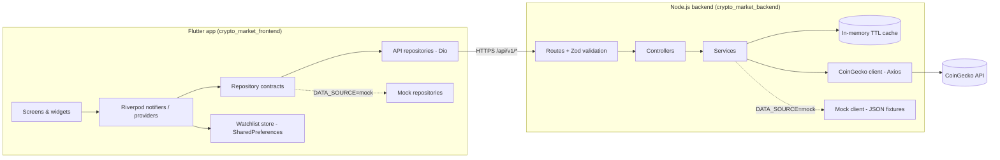
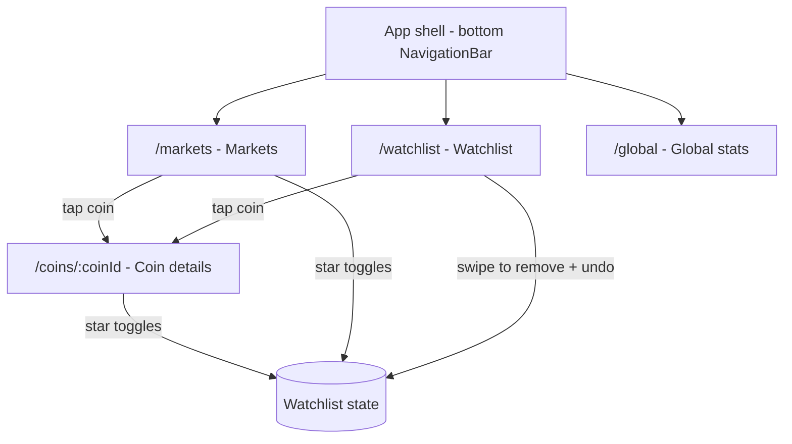
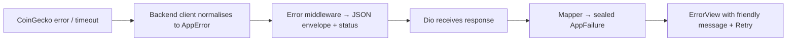

# Architecture — Crypto Market & Research App

> Status: Phase 2 plan. This document is updated as phases are implemented, so it always describes
> the real code.

## 1. System overview



**Why a backend at all?** (1) The CoinGecko API key must never ship inside a mobile app, where it can
be extracted. (2) One cached upstream call serves every user, keeping us inside the free plan's rate
limit. (3) The app gets a small, stable, documented contract (`docs/api-contract.md`) instead of the
provider's large raw format.

## 2. Repositories and folders

| Repo | Path | Contents |
|---|---|---|
| Mobile | `D:\crypto_market\crypto_market_frontend` ([GitHub](https://github.com/ragavendars21/crypto_market_frontend)) | Flutter app, `docs/`, `README.md` |
| Backend | `D:\backend\crypto_market_backend` ([GitHub](https://github.com/ragavendars21/crypto_market_backend)) | Express API |

### 2.1 Flutter app (`crypto_market_frontend/lib`)

```text
lib/
├── main.dart                     # Bootstrap: load SharedPreferences, create ProviderScope
├── app.dart                      # MaterialApp.router + themes
├── core/
│   ├── config/app_config.dart    # Reads --dart-define values (API_BASE_URL, DATA_SOURCE)
│   ├── di/repository_providers.dart # The one place mock vs live repositories are chosen
│   ├── mock/mock_market_data.dart   # Sample data in the API contract's JSON shape
│   ├── network/                  # Dio instance, interceptors, DioException → AppFailure mapping
│   ├── errors/app_failure.dart   # Sealed failure types shown by the UI
│   ├── routing/app_router.dart   # GoRouter configuration
│   └── theme/                    # Design tokens: colors, spacing, radii, typography, ThemeData
├── shared/
│   ├── widgets/                  # Reusable UI: CoinLogo, PriceChangeIndicator, ErrorView, ...
│   └── formatters/               # Currency, compact number, percentage, supply, date formatting
└── features/
    ├── market/                   # Market list, search, sort, filters
    │   ├── domain/               # CoinSummary entity, MarketQuery, MarketRepository contract
    │   ├── data/                 # DTOs, API + mock repository implementations
    │   ├── application/          # Riverpod providers / notifiers
    │   └── presentation/         # MarketScreen + feature widgets
    ├── coin_details/             # Details screen + price chart
    ├── market_stats/             # Global statistics screen
    └── watchlist/                # Watchlist persistence + screen
```

**Layer responsibilities**

| Layer | Contains | May depend on |
|---|---|---|
| `presentation` | Screens, widgets, rendering of loading/error/empty states | `application`, `domain`, `shared` |
| `application` | Riverpod providers and notifiers; orchestration | `domain` (contracts only) |
| `domain` | Plain immutable entities, repository contracts, small pure business rules | nothing (pure Dart) |
| `data` | DTOs (`json_serializable`), Dio calls, DTO → entity mapping, SharedPreferences | `domain`, `core/network` |

`application` never imports `data` directly. The concrete repositories are chosen in
`core/di/repository_providers.dart`, the single place mock mode is switched. Tests override those
providers with fakes.

**Cross-feature reuse:** `CoinSummary` and `MarketRepository` live in `features/market/domain`. The
watchlist feature reuses them (it fetches its coins with `ids=`) instead of duplicating the model.

### 2.2 Backend (`crypto_market_backend`)

```text
src/
├── server.js            # Starts HTTP server (only file that listens on a port)
├── app.js               # Builds the Express app (imported by tests via Supertest)
├── config/env.js        # Zod-validated environment variables; fails fast on startup
├── routes/              # Paths + validation middleware
├── controllers/         # Read validated input → call service → send envelope
├── services/            # Business logic: top-250 filtering/sorting/paging, caching
├── clients/             # coinGeckoClient.js (Axios) and mockCoinGeckoClient.js (fixtures)
├── mappers/             # Provider JSON → our contract (null-safe)
├── schemas/             # Zod request schemas
├── middleware/          # validate, error handler, not-found, rate limiter
├── utils/               # ttlCache.js, AppError.js, response helpers
└── fixtures/            # Raw CoinGecko-shaped JSON used by mock mode and tests
tests/                   # Vitest + Supertest
docs/openapi.yaml        # OpenAPI 3 spec served at /api-docs
```

Mock mode replaces the **client**, not the service. That way the mappers, filtering and caching code
runs on fixture data, so mock mode exercises nearly all of the real code.

## 3. Screen flow and navigation



- GoRouter `StatefulShellRoute.indexedStack` keeps each tab's scroll position and state when switching tabs.
- `/coins/:coinId` is a top-level route pushed over the shell (full screen, back button). Deep links
  such as `/coins/bitcoin` work because the screen loads its data from the ID alone.

| Screen | Main content |
|---|---|
| Markets | Global summary strip (total market cap, 24h change, BTC dominance) → search field → sort and filter chips → paginated coin list with pull-to-refresh |
| Coin details | Header (logo, name, symbol, rank, watchlist star) → price + 24h change → chart card with range selector (1D/7D/30D/1Y) → % change grid → market data grid (market cap, FDV, volume, 24h high/low) → supply section (circulating / total / max with progress bar only when max exists) → ATH/ATL → "Last updated" + attribution |
| Global | Hero card (total market cap + 24h change) → volume card → dominance donut chart + legend → stat cards (active cryptos, markets, volume change) → updated time |
| Watchlist | Saved coins as `CoinListTile`s, swipe to remove with undo SnackBar, empty state with "Explore markets" button |

## 4. State management (Riverpod)

| Provider | Type | Responsibility |
|---|---|---|
| `marketRepositoryProvider` | `Provider<MarketRepository>` | Chooses API or mock implementation |
| `marketQueryProvider` | `NotifierProvider<MarketQuery>` | Current search text (debounced), sort, movement, tier |
| `marketListProvider` | `AsyncNotifierProvider<MarketListState>` | Watches the query; loads page 1, `loadNextPage()`, `refresh()` |
| `coinDetailsProvider(id)` | `FutureProvider.autoDispose.family` | Coin details; kept 2 min after the screen closes |
| `priceHistoryProvider((coinId:, range:))` | `FutureProvider.autoDispose.family` | Chart points for one range; kept 2 min, so switching back to a range reuses its data |
| `globalStatsProvider` | `FutureProvider` | Global statistics |
| `watchlistProvider` | `NotifierProvider<List<String>>` | Saved IDs in insertion order; toggle/remove/restore (Undo); optimistic updates rolled back if saving fails; max 50 (the backend's `ids` limit) |
| `watchlistCoinsProvider` | `AsyncNotifierProvider` | Fetches saved coins with `ids=`; a removal filters already-loaded data instead of making a request; `refresh()` always fetches |
| `watchlistSortProvider` / `sortedWatchlistProvider` | `Notifier` / `Provider` | Client-side sort of the loaded coins, filtered synchronously by the current IDs so swipe-to-dismiss removes rows instantly |

**Data flow example — sorting the market list:**

1. User taps "Price ↓" → `marketQueryProvider.notifier.setSort(price_desc)`.
2. `marketListProvider` watches the query, so Riverpod rebuilds it and resets to page 1.
3. The notifier calls `MarketRepository.getCoins(query, page: 1)` → Dio → `GET /api/v1/coins?sort=price_desc`.
4. The response DTO is mapped to `CoinSummary` entities; state becomes `AsyncData`.
5. `MarketScreen` uses `ref.watch(marketListProvider)` and `switch`es on loading / error / data.

**Watchlist sync:** every star button watches `watchlistProvider.select((ids) => ids.contains(id))`,
so toggling a coin rebuilds only the stars for that coin on every screen. SharedPreferences is
loaded once in `main()` and injected through a provider override, so reads are synchronous afterwards.

**Search:** the query text is debounced (350 ms) in `MarketQueryController`, the keyboard's search
key applies it immediately, and an update that produces an equal `MarketQuery` (value equality,
trimmed search) is ignored, so typing doesn't send a request per keystroke. Filter chips watch
only their own field with `select`, so typing doesn't rebuild them. Clearing search and filters
keeps the chosen sort. Search and filtering are **server-side**
(applied by the backend to the top 250). Only the watchlist, which has at most 50 coins already on
the device, is sorted **client-side**.

## 5. Error handling



Flutter `AppFailure` types (sealed class, so `switch` is exhaustive):

| Failure | Cause | Message shown |
|---|---|---|
| `NetworkFailure` | No connection, DNS, connection refused | "You appear to be offline. Check your connection." |
| `TimeoutFailure` | Dio timeout or `UPSTREAM_TIMEOUT` | "The server took too long to respond." |
| `RateLimitedFailure` | `RATE_LIMITED` / `UPSTREAM_RATE_LIMITED` (+ retry-after) | "Too many requests. Please try again in N seconds." |
| `NotFoundFailure` | `COIN_NOT_FOUND` | "This coin could not be found." |
| `ServerFailure` | Other 4xx/5xx | "Something went wrong on our side." |

Raw exceptions are logged in debug builds only and never shown to the user.

**Partial data:** if page 2 fails, the coins already loaded stay on screen and a retry row appears
at the end of the list. If the backend reports `meta.source = "stale"`, a small banner says the
prices may be out of date.

## 6. Design system

**Identity:** "calm terminal". The app is dark-first, with a deep ink background, one electric accent,
and tabular figures so prices don't shift as they update. A light theme uses the same tokens.

| Token | Dark | Light | Use |
|---|---|---|---|
| `background` | `#0B0F17` | `#F6F7FB` | Scaffold |
| `surface` | `#131A26` | `#FFFFFF` | Cards, tiles |
| `surfaceRaised` | `#1B2433` | `#EEF1F7` | Chips, inputs |
| `outline` | `#263042` | `#DDE2EC` | Dividers, card borders |
| `primary` | `#5B8CFF` | `#3A6BF0` | Accent, selected tab, chart line (neutral) |
| `positive` | `#16C784` | `#0FA36B` | Price up |
| `negative` | `#EA3943` | `#D92D3A` | Price down |
| `textPrimary` | `#E7ECF5` | `#0F172A` | Main text |
| `textSecondary` | `#8A96AD` | `#5B6578` | Labels, metadata |

Positive and negative are provided through a `ThemeExtension` (`AppColors`), because Material's
`ColorScheme` has no "price up/down" roles. Direction is never shown by colour alone: there is
always a ▲/▼ icon and a +/− sign.

| Scale | Values |
|---|---|
| Spacing | 4, 8, 12, 16, 24, 32 (`AppSpacing.xs … xxl`) |
| Radii | 8 (chips), 12 (tiles, inputs), 16 (cards), 24 (bottom sheets) |
| Icon sizes | 16, 20, 24 |
| Coin logo sizes | 32 (list), 40 (watchlist), 56 (details header) |
| Touch targets | ≥ 48 × 48 dp |

**Typography:** Inter, bundled as an asset so it works offline. Prices and numbers use
`FontFeature.tabularFigures()`. Scale: display 32/700 (detail price), title 20/600, body 15/400,
label 13/500, caption 12/400.

**Charts:** line colour is `positive` or `negative` depending on whether the range's last price is
above its first price, with a soft gradient fill. Horizontal grid lines are faint and there are no
vertical grid lines. The touch tooltip shows price and date/time. The y-axis uses compact currency
labels, and the x-axis uses time labels suited to the range (hours for 1D, days for 7D/30D, months
for 1Y).

**Reusable widgets (planned):** `CoinLogo`, `CoinListTile`, `PriceChangeIndicator`, `WatchlistButton`,
`MarketStatCard`, `SectionHeader`, `SearchAndFilterBar`, `PriceChart`, `LoadingView` (shimmer
skeletons that match the final layout), `ErrorView`, `EmptyStateView`, `StaleDataBanner`.

**Formatting rules** (`shared/formatters`):

| Value | Example | Rule |
|---|---|---|
| Price ≥ $1 | `$67,012.50` | 2 decimals |
| Price < $1 | `$0.00001234` | Up to 4 significant digits after leading zeros |
| Market cap / volume | `$1.32T`, `$812.4M` | Compact, 1–2 decimals |
| Supply | `19.71M BTC` | Compact + symbol |
| Percentage | `+5.58%` / `−2.40%` | 2 decimals, explicit sign |
| Missing value | `—` | Any `null`, with semantic label "Not available" |

## 7. Key decisions and trade-offs

| Decision | Alternative considered | Why |
|---|---|---|
| Backend filters/sorts a cached top-250 set | Pass sort straight to CoinGecko | CoinGecko can't sort by price or % change; one cached call per minute serves all queries |
| Hand-written Riverpod notifiers (no codegen) | `riverpod_generator` | Less generated "magic" to explain; codegen can be added later |
| `json_serializable` for DTOs only; plain domain entities | `freezed` everywhere | Keeps generated code to JSON parsing; entities stay readable |
| SharedPreferences for watchlist IDs | Hive / SQLite / Isar | We store only a list of strings; a database is unnecessary |
| Hand-written TTL cache | `node-cache`, Redis | About 30 lines and easy to explain; Redis is only needed with multiple instances |
| Express 5 | Express 4, Fastify | Express 5 forwards async errors to the error middleware natively; Express is what you already know |
| Mock mode in both apps | Live data only | Deterministic tests, offline development, no API key needed until Phase 10 |
| USD only | Currency picker | Not required; it would multiply cache keys and UI states |
| Dominance as a 100% stacked bar + legend | Pie / donut chart | Lengths on one line compare more accurately than angles; the legend names every segment, so color is never the only cue |
| Fixed chart color per coin (BTC always slot 1) | Color by rank | A coin keeps its color when rankings change; palette checked with a validator for color-blind separation and contrast in both themes |
| SharedPreferences loaded once in `main()` and injected | Read asynchronously everywhere | Watchlist state can then be read synchronously, so stars render correctly on the first frame |
